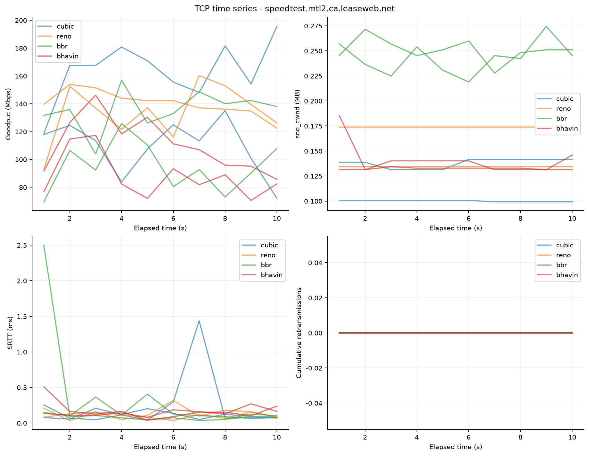
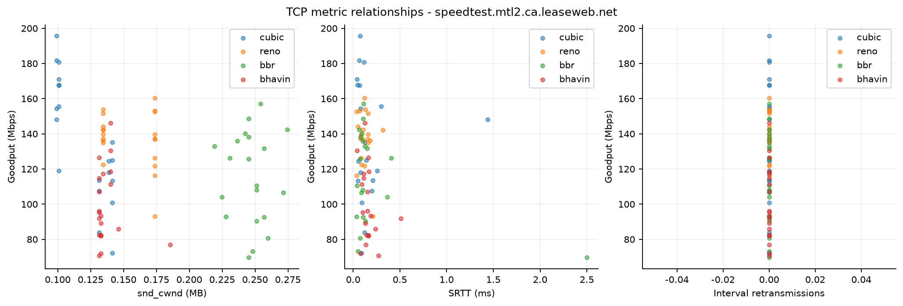

# Assignments 2 and 3: TCP Congestion Control

## Assignments 2 and 3: TCP Congestion Control

Bhavin Gupta | CS 422: Computer Networks | Fall 2026

Repository: https://github.com/bvin02/CS42200-Fall26-Assignment2-3

Host kernel: 6.8.0-147-generic. Available congestion controls: reno, cubic, bbr, bhavin. Completed runs: 23; failed runs: 38.

Configuration: 3 destinations, 10.0 seconds, 1.0 second sampling, 2 repetition(s), seed 422. Algorithms were shuffled within each destination/repetition; the exact order is in runs.json.

Reproduce on the configured native Linux host with: python3 experiment.py collect --servers inputs/servers_us.txt --output results --destinations 3 --duration 10 --interval 1 --repetitions 2 --algorithms cubic,reno,bbr,bhavin.

AI assistance was used to inspect the published iperf3 protocol state machine, draft code and tests, and check report completeness. The implementation was verified against automated unit/integration tests and the official protocol behavior; I reviewed the code and remain responsible for explaining it.

## Assignment 2 - implementation and measurements

The Python client creates an iperf3 control socket, sends a 37-byte cookie, handles PARAM_EXCHANGE, sends length-prefixed JSON parameters, opens a separate data socket with the chosen TCP_CONGESTION value, transmits data, sends TEST_END, exchanges result JSON, and finishes with IPERF_DONE. It never invokes the iperf3 executable.

Each sample comes from getsockopt(TCP_INFO) on the data socket. Goodput is 8 times the increase in cumulative bytes_acked divided by the actual monotonic elapsed interval. snd_cwnd is converted from segments to bytes using snd_mss. SRTT and rttvar are kernel microseconds. total_retrans is cumulative; retrans_interval is its nonnegative interval delta.

The representative destination used in the figures is speedtest.mtl2.ca.leaseweb.net. Completed algorithms were bbr, bhavin, cubic, reno.

The largest observed mean goodput was 137.06 Mbps for reno to speedtest.mtl2.ca.leaseweb.net.  Across all accepted samples, bbr averaged 125.47 Mbps, had 0.10 ms median SRTT, and logged 0 interval retransmission increments; bhavin averaged 110.29 Mbps, had 0.14 ms median SRTT, and logged 0 interval retransmission increments; cubic averaged 130.24 Mbps, had 0.12 ms median SRTT, and logged 0 interval retransmission increments; reno averaged 134.93 Mbps, had 0.11 ms median SRTT, and logged 0 interval retransmission increments. A larger congestion window permits more outstanding bytes, but useful rate is limited by the path bandwidth-delay product. Higher RTT delays feedback; rising RTT commonly indicates queueing. Retransmission increments are a loss proxy and can coincide with a window reduction. Zero retransmissions do not prove zero congestion because ECN, application limits, and receiver limits may also matter. Across repetitions, bbr run means ranged from 94.95 to 136.75 Mbps; bhavin run means ranged from 74.23 to 150.43 Mbps; cubic run means ranged from 106.40 to 164.11 Mbps; reno run means ranged from 125.77 to 141.00 Mbps.

CUBIC grows its window as a cubic function of time since congestion and is intended to scale on large bandwidth-delay products. Reno uses additive increase and multiplicative decrease and is often competitive on smaller BDP paths but reacts conservatively to loss. BBR estimates bottleneck bandwidth and minimum RTT, so it can perform well on large-BDP or non-congestion-loss paths without filling a large buffer. This run includes live BBR measurements on the same destinations and schedule as the other algorithms.

Limitations: Public servers, routes, cross traffic, and server load change over time, so algorithm differences are not controlled causal estimates.

## Assignment 2 - hand-written congestion-control design

BhavinCC starts with the kernel initial congestion window and tracks minimum RTT, an RTT EWMA, delivery throughput, and recent loss. On each ACK: compute queue_ratio=(srtt-min_rtt)/min_rtt. If loss occurred, set cwnd=max(4,0.70*cwnd). Else if queue_ratio>0.25 and delivered throughput did not improve, reduce cwnd by max(1,cwnd/16). Else if queue_ratio<0.10, increase cwnd by approximately one segment per RTT; in the middle region increase more slowly. The included tcp_bhavin.c implements these rules in Linux congestion-control callbacks. The 0.70 multiplicative decrease yields convergence under persistent loss, while RTT-gradient avoidance reduces standing queues. RTT unfairness can remain because shorter-RTT flows receive ACK feedback sooner; noisy wireless loss and route changes can also cause false reductions.

## Assignment 3 - Option 1 implementation and evaluation

Assignment 3 uses Option 1 (kernel implementation). The module registers the name bhavin, records its selection through TCP_CONGESTION, and shares the same client, logging, and plotting path as the baselines. From the kernel directory, build with make, load with sudo insmod tcp_bhavin.ko, and unload with sudo rmmod tcp_bhavin. A matching /lib/modules kernel build tree, CONFIG_MODULES, and root privileges are required. For this experiment, BhavinCC compiled against and loaded into the running 6.8.0-147-generic kernel; tcp_bbr was also loaded, and both names were verified through TCP_CONGESTION before collection.

The live comparison completed 5 CUBIC, 6 Reno, 6 BBR, and 6 BhavinCC runs on the accepted destinations. The figures and aggregates use only successful runs; public-server failures remain in runs.json.

## Files and verification

Core protocol and TCP_INFO code: experiment.py. Custom kernel algorithm: kernel/tcp_bhavin.c. Automated tests: tests/test_experiment.py. Server input: inputs/servers_us.txt. Raw status, samples, aggregates, and environment evidence are stored together in this output directory. Plot-generating function: render_results in experiment.py.

Code links: iperf3 state machine https://github.com/bvin02/CS42200-Fall26-Assignment2-3/blob/main/experiment.py#L168; TCP_INFO decoding https://github.com/bvin02/CS42200-Fall26-Assignment2-3/blob/main/experiment.py#L87; collection pipeline https://github.com/bvin02/CS42200-Fall26-Assignment2-3/blob/main/experiment.py#L314; plot/report generation https://github.com/bvin02/CS42200-Fall26-Assignment2-3/blob/main/experiment.py#L416; BhavinCC window update https://github.com/bvin02/CS42200-Fall26-Assignment2-3/blob/main/kernel/tcp_bhavin.c#L34.

The percentile method is linear interpolation at rank (n-1)*0.95 after sorting. All rates use decimal SI units (1 Mbps = 1,000,000 bits/s).

